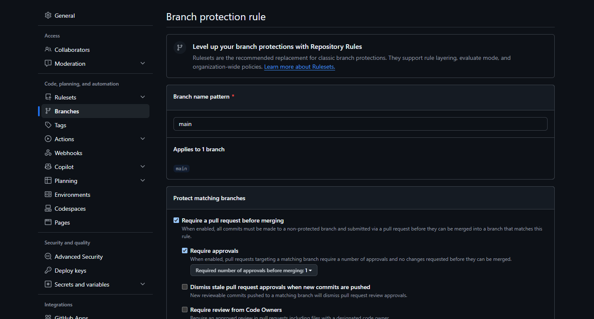
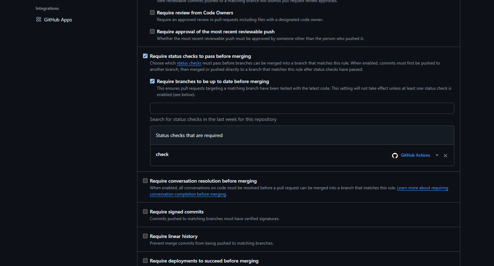
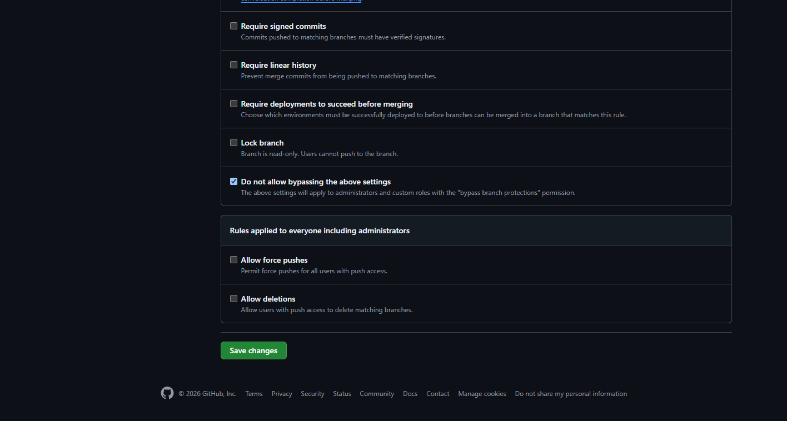
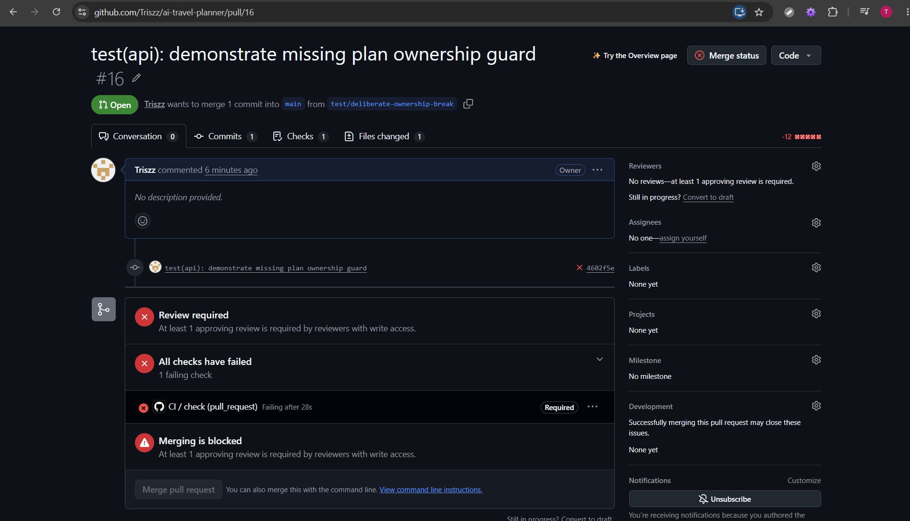
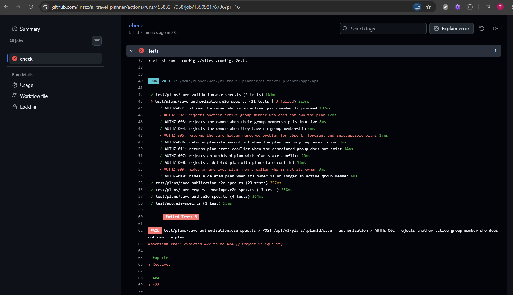
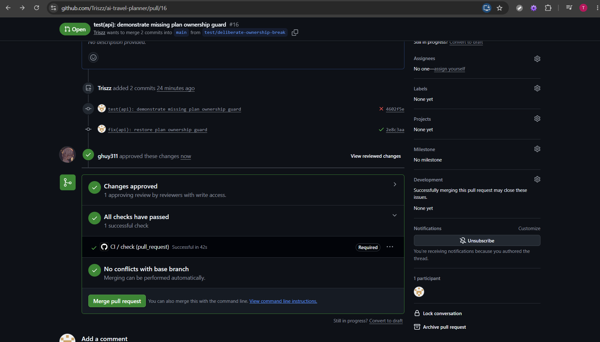

# PA#2 — Evidence Index

**Project:** AI Travel Planner
**Course:** CSC13114 — Class 23KTPM1
**Team members:**

- 23127376 — Hồ Gia Huy
- 23127503 — Trần Thanh Trí

## 1. Repository

- **GitHub repository:** https://github.com/Triszz/ai-travel-planner
- **Default branch:** `main`

## 2. Protected Branch Settings

The `main` branch is configured with the following protection rules:

- Require a pull request before merging.
- Require at least one approving review.
- Require status checks to pass before merging.
- Require branches to be up to date before merging.
- Require the `check` status check.
- Do not allow bypassing the above settings, including for administrators.
- Force pushes and branch deletions are not allowed.

**Evidence:** docs/evidence/branch-protection-1.png, docs/evidence/branch-protection-2.png, docs/evidence/branch-protection-3.png

## 3. Pull Request Blocked by CI

**Pull Request:** [#16 — test(api): demonstrate missing plan ownership guard](https://github.com/Triszz/ai-travel-planner/pull/16)

The pull request deliberately removed the controller-level ownership guard while keeping the contract and tests unchanged.

The required CI check failed because requests involving plans owned by another user no longer produced the contractually required `404 plan-not-found` response.

**Evidence:**

- [Failing CI run — PR #16](https://github.com/Triszz/ai-travel-planner/actions/runs/45583217958/job/139098176736?pr=16)
- Deliberate-break commit: `4602f5e` — `test(api): demonstrate missing plan ownership guard`

The pull request was also subject to the required review rule. The CI failure and the review requirement are separate merge conditions.

## 4. Pull Request Turned Green

The ownership guard was restored without modifying the contract or weakening the tests.

**Pull Request:** [#16 — test(api): demonstrate missing plan ownership guard](https://github.com/Triszz/ai-travel-planner/pull/16)

**Repair commit:** `2e8c3aa` — `fix(api): restore plan ownership guard`

**Evidence:**

- [Successful CI run — repaired PR #16](https://github.com/Triszz/ai-travel-planner/actions/runs/45585706320/job/139106634824)

The required `check` status check passed for the repaired commit.

## 5. CI Run for Submission Tag

**Tag:** `pa2`

**CI run:** [Successful GitHub Actions run for tag `pa2`](https://github.com/Triszz/ai-travel-planner/actions/runs/45603750379)

The submission tag must point to the final commit being submitted. The CI workflow runs the repository checks for tags matching `pa*`.

## 6. Deliberate Contract Break

The deliberate break was introduced in commit `4602f5e` on branch `test/deliberate-ownership-break`.

The controller-level ownership check was removed, while:

- The endpoint contract remained unchanged.
- The authorization tests remained unchanged.
- The commit-time ownership check remained in place.

This caused three authorization E2E tests to fail because the endpoint returned `422` or `409` instead of the contractually required `404` for inaccessible plans.

The ownership guard was restored in commit `2e8c3aa`. No contract or test changes were made to make the failing checks pass.

**Evidence:**

- [Deliberate-break commit](https://github.com/Triszz/ai-travel-planner/commit/4602f5e)
- [Failing CI run](https://github.com/Triszz/ai-travel-planner/actions/runs/45583217958/job/139098176736?pr=16)
- [Repair commit](https://github.com/Triszz/ai-travel-planner/commit/2e8c3aa)
- [Successful CI run](https://github.com/Triszz/ai-travel-planner/actions/runs/45585706320/job/139106634824)

---

**Submission note:** This document is an evidence index. The linked repository, pull requests, commits, screenshots, and CI runs are the evidence for the claims above.
