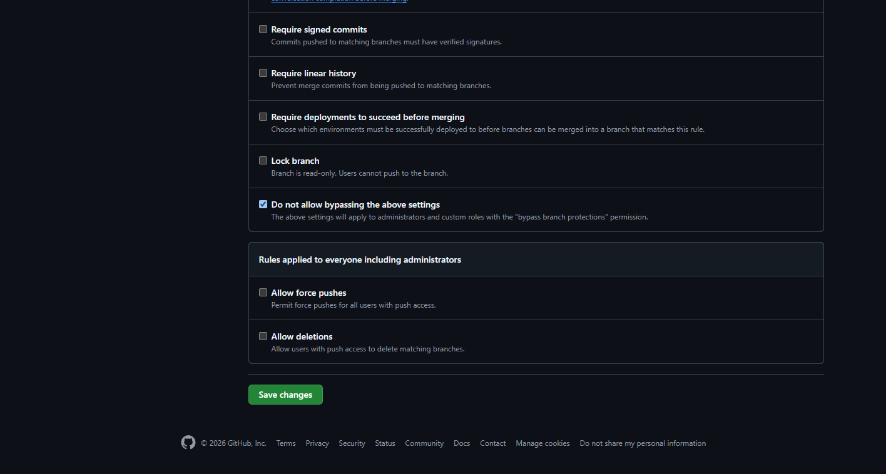
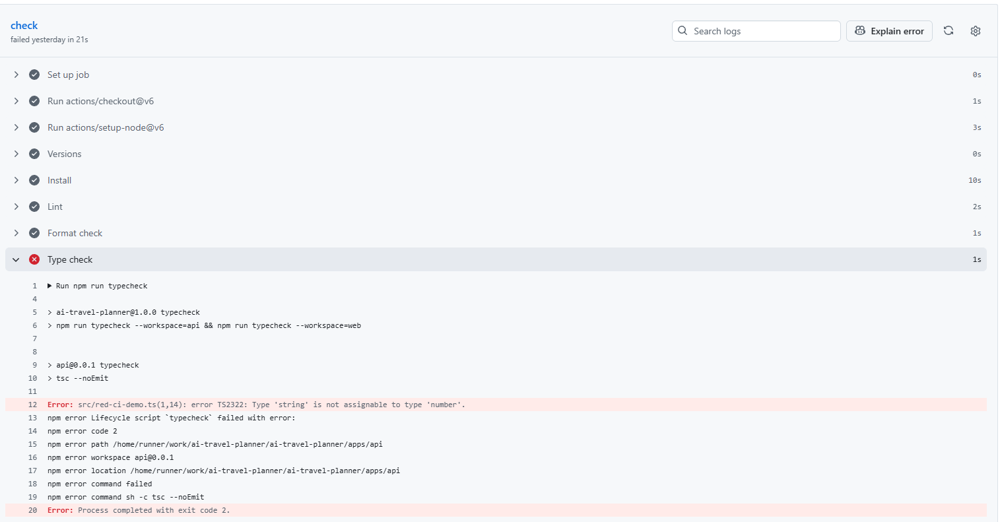

# CI and branch protection evidence

## CI
- Workflow: `.github/workflows/ci.yml`, job `check`, runs `npm ci`, `lint`, `format:check`, `typecheck`, `test` on pull requests, pushes to `main` and `pa*` tags.
- First CI run (red, Linux lockfile problem): https://github.com/Triszz/ai-travel-planner/actions/runs/44520411308/job/135547254925
- Green run on the CI pull request: https://github.com/Triszz/ai-travel-planner/actions/runs/44523646779/job/135558420546
- PR that added CI: https://github.com/Triszz/ai-travel-planner/pull/10

## Branch protection on `main`
- Settings screenshot: 
 

- Rule: pull request required (1 approval), required1 status check `check`, branch must be up to date, no bypass for admins, no force push, no deletion.
- Enabled Ty: @Triszz, time : 19h30 19/11/2026
- Merge method: merge commit only (squash and rebase disabled).

## Red CI demonstration
- PR: https://github.com/Triszz/ai-travel-planner/pull/11
- Failing commit: f52712f ("test: deliberately break typecheck to prove CI blocks the merge")
- Red run: https://github.com/Triszz/ai-travel-planner/actions/runs/44527081385/job/135570381809, failing step: Type check
- Fix commit: 39f2680 ("fix: remove deliberate type error")
- Green run: https://github.com/Triszz/ai-travel-planner/actions/runs/44527939778/job/135573366187
- Screenshots: 

## No direct pushes since protection was enabled
Command: `git log --first-parent --no-merges --format='%h %ad %s' --date=iso main`
It lists commits that were added to `main` directly instead of through a merge. All of them must be dated before protection was enabled.
Result: 023570f 2026-11-16 21:49:02 +0700 first commit
