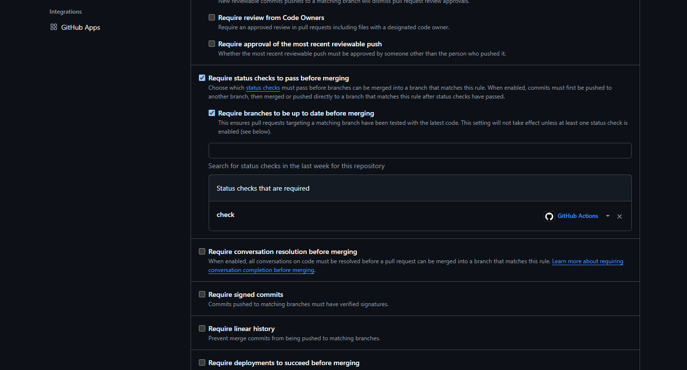
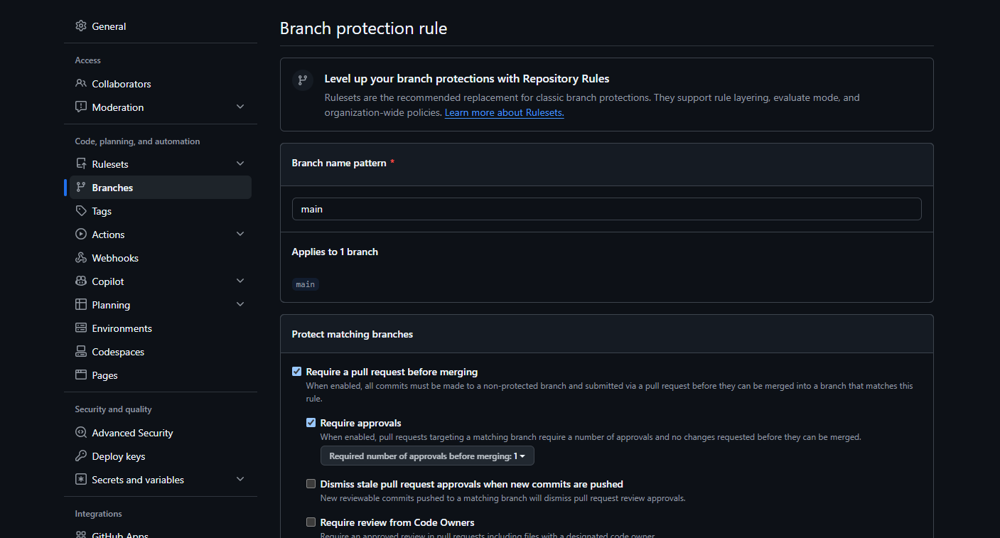
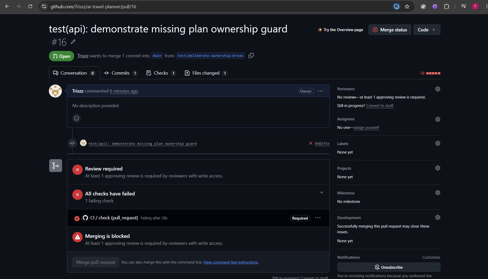
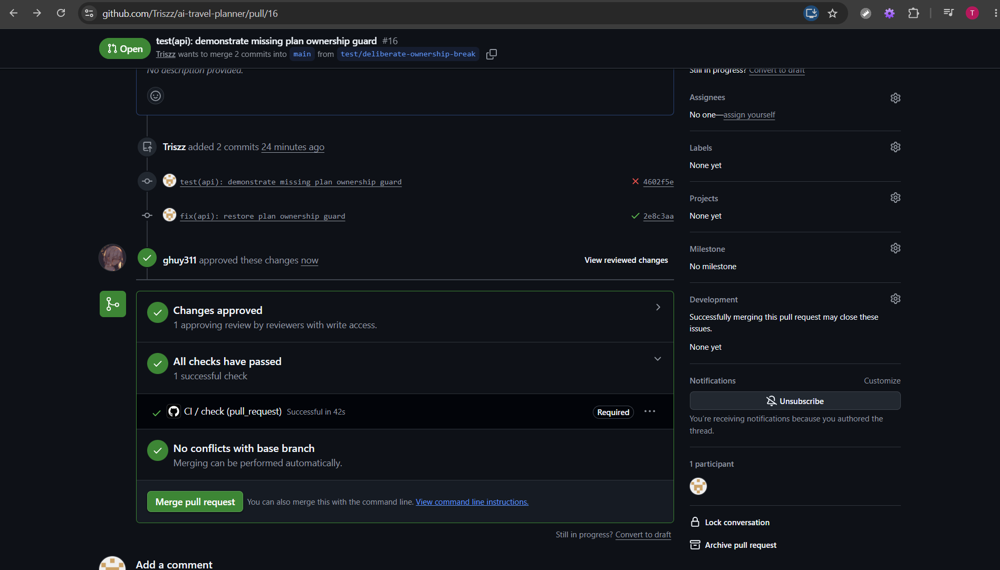

# CI and branch protection evidence

## CI

- Workflow: `.github/workflows/ci.yml`, job `check`, runs `npm ci`, `npm run lint`, `npm run format:check`, `npm run typecheck`, `npm test` on pull requests, pushes to `main` and `pa*` tags.
- First CI run (red, Linux lockfile problem): https://github.com/Triszz/ai-travel-planner/actions/runs/44520411308/job/135547254925
- Green run on the CI pull request: https://github.com/Triszz/ai-travel-planner/actions/runs/44523646779/job/135558420546
- PR that added CI: https://github.com/Triszz/ai-travel-planner/pull/10

## Branch protection on `main`

- Settings screenshot: 
  
  
- Rule: pull request required (1 approval), required status check `check`, branch must be up to date, no bypass for administrators, no force pushes, and no branch deletions.
- Enabled by: @Triszz on 2026-11-19 at 19:30 (+07:00)
- Merge method: merge commit only (squash and rebase disabled).

## Red CI demonstration

- PR: https://github.com/Triszz/ai-travel-planner/pull/16
- Failing commit: 4602f5e ("test(api): demonstrate missing plan ownership guard")
- Red run: https://github.com/Triszz/ai-travel-planner/actions/runs/45583217958/job/139098176736?pr=16, failing step: Missing plan ownership
- Fix commit: 2e8c3aa ("fix(api): restore plan ownership guard")
- Green run: https://github.com/Triszz/ai-travel-planner/actions/runs/45585706320/job/139106634824
- Screenshots:
  
  
  

## Direct-push history check

- Command: `git log --first-parent --no-merges --format='%h %ad %s' --date=iso main`
- Observed result: `023570f` — 2026-11-16 21:49:02 +0700 — first commit.
- Branch protection was enabled on 2026-11-19.
- No non-merge commits were observed on the first-parent history after branch protection was enabled.
